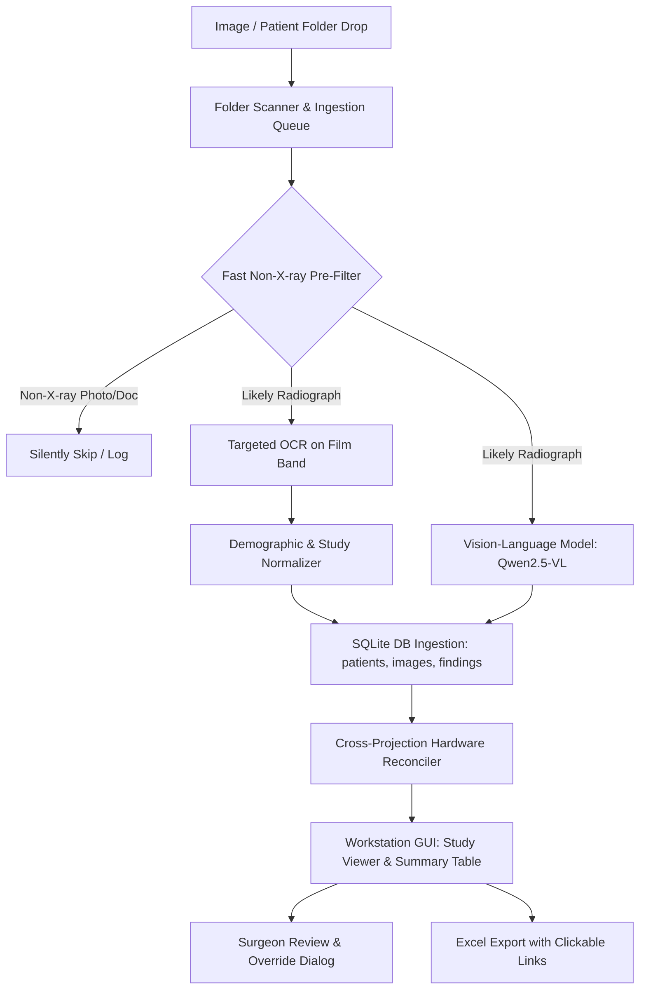

# BoneChilling 🦴
### High-Performance Orthopedic Radiology Workstation & AI Ingestion Pipeline

**BoneChilling** is an intelligent desktop workstation and radiographic data ingestion pipeline designed for orthopedic surgeons and clinical radiologists. It streamlines the review, organization, and analysis of multi-projection X-ray studies (AP, Lateral, Oblique, etc.) by combining localized Optical Character Recognition (OCR), metadata normalization, local Vision-Language AI (`Qwen2.5-VL` via Ollama), and cross-projection implant reconciliation.

---

## Key Highlights

- **Desktop Workstation GUI**: Dark-mode clinical interface built with PySide6, featuring a multi-projection film canvas, interactive patient worklist, and unified clinical assessment inspector.
- **Continuous Background Queue**: Asynchronous, multi-patient ingestion queue with Drag & Drop support for batch folders (50+ patient directories), real-time progress metrics, and a dedicated Queue Manager dialog.
- **Fast Pre-Filter Heuristics**: Ultra-fast (~5ms) image classifier that filters out non-X-ray images (prescriptions, wound photographs, white paper documents) before burning CPU/GPU cycles.
- **Targeted OCR & Normalization**: Tesseract-powered extraction focused on the bottom label band with 3x bilinear upscaling and autocontrast stretching, parsed into typed demographic and study fields.
- **Objective Radiographic Fact Extraction**: Local Vision-Language Model (`qwen2.5vl:3b` / `7b` via Ollama) extracts verifiable radiographic findings (bone alignment, joint spaces, implant counts, integrity) without speculative diagnostic hallucination.
- **Cross-Projection Hardware Reconciliation**: Correlates implants visible across orthogonal views (e.g., AP and Lateral) to prevent double-counting and verify multi-angle structural integrity.
- **Surgeon Review & Verification Loop**: Status workflow (`unreviewed`, `verified`), editable findings overrides, clinical remarks logging, and audit timestamps.
- **Spreadsheet Export with Hyperlinks**: Automated Excel export (`.xlsx`) featuring styled tables, clinical remarks, and clickable hyperlinks directly to patient folders on disk.

---

## Architecture & Data Flow



---

## Project Structure

```
BoneChiling/
├── main.py                  # Workstation application entry point (PySide6)
├── import_page.py           # Core GUI: Study Viewer, Summary Table, Queue Manager, Edit Dialog
├── worker.py                # Asynchronous QThread background ingestion queue & folder discovery
├── pipeline.py              # CLI batch ingestion runner
├── vision.py                # Ollama Qwen2.5-VL vision analysis & fast non-X-ray heuristic filter
├── ocr.py                   # Tesseract label-band reader with bilinear upscaling & autocontrast
├── normalize.py             # Regex engine converting messy OCR text to structured clinical fields
├── db.py                    # SQLite database schema, WAL configuration, queries & hardware reconciler
├── evaluate_test_batch.py   # Benchmark test suite for timing and accuracy evaluation
├── eval_results.json        # Detailed metrics and timing outputs from batch runs
├── pyproject.toml           # Project dependencies and packaging configuration
├── data/                    # Sample X-ray images
└── test/                    # Multi-patient evaluation batch folders
```

---

## Prerequisites

1. **Python 3.9+** (Python 3.11 or 3.12 recommended)
2. **Tesseract OCR Engine**:
   - **macOS** (Homebrew):
     ```bash
     brew install tesseract
     ```
   - **Ubuntu / Debian**:
     ```bash
     sudo apt-get update && sudo apt-get install -y tesseract-ocr
     ```
   - **Windows**: Install via [UB-Mannheim Tesseract installer](https://github.com/UB-Mannheim/tesseract/wiki) and ensure `tesseract` is added to your system `PATH`.
3. **Ollama** (for local vision AI inference):
   - Install Ollama from [ollama.ai](https://ollama.ai) or via Homebrew (`brew install ollama`).
   - Pull the recommended vision model:
     ```bash
     ollama pull qwen2.5vl:3b
     # Or for machines with >= 16GB RAM/VRAM:
     # ollama pull qwen2.5vl:7b
     ```
   - Ensure the Ollama daemon is running:
     ```bash
     ollama serve
     ```

---

## Installation

Using [`uv`](https://github.com/astral-sh/uv) (recommended) or standard `pip`:

### Using `uv`
```bash
# Clone the repository
git clone <repo-url>
cd BoneChiling

# Create virtual environment and sync dependencies
uv sync
```

### Using `pip`
```bash
python3 -m venv .venv
source .venv/bin/activate  # On Windows: .venv\Scripts\activate
pip install -e .
```

---

## Usage

### 1. Launching the Workstation GUI
```bash
python main.py
```
- **Study Viewer**: Browse patients from the left worklist, switch between multiple projections (AP, Lateral, Oblique) using the top pill bar, inspect AI findings, and record surgeon notes.
- **Summary Table**: View consolidated patient records, filter by name/anatomy/implant, and double-click any row to inspect the full case.
- **Drag & Drop Ingestion**: Drag patient folders or a multi-folder batch root directly onto the window.
- **Queue Manager**: Click `● Queue` in the top bar to inspect queued folders, pause/resume processing, or clear the queue.
- **Excel Export**: Click `📊 Download Excel Sheet` to generate a styled report with clickable links to local patient folders.

### 2. Running Batch Ingestion via CLI
Ingest any patient directory directly into the SQLite database without launching the GUI:
```bash
python pipeline.py path/to/patient_or_batch_folder
```

### 3. Running Component Self-Tests

- **Test OCR on an X-ray**:
  ```bash
  python ocr.py data/elbow1.jpg
  ```
- **Test Demographics Normalization**:
  ```bash
  python normalize.py data/elbow1.jpg
  ```
- **Test Vision Fact Extraction**:
  ```bash
  python vision.py data/elbow1.jpg
  ```
- **Run Batch Evaluation**:
  ```bash
  python evaluate_test_batch.py
  ```

---

## Database Architecture (`xray.db`)

The application uses an embedded SQLite database configured with **Write-Ahead Logging (WAL)** and foreign key enforcement for concurrent GUI reading and background worker writing.

- **`patients`**: Stores consolidated patient demographics (`name`, `patient_id`, `age`, `sex`), `review_status` (`unreviewed`, `verified`), `surgeon_notes`, `verified_hardware`, and `verified_facts`.
- **`images`**: Stores individual projection records (`file_path`, `study_date`, `body_part`, `views`, `raw_ocr`).
- **`findings`**: Stores AI-extracted observations per image (`hardware`, `impression`, `confidence`).

---

## Technical Details

### Orthogonal Hardware Reconciliation
When multiple projections of the same anatomical region are captured (such as Anteroposterior and Lateral views), individual AI evaluations detect the same implants from different perspectives. BoneChilling's reconciliation engine (`reconcile_hardware_cross_projections`):
1. Categorizes implants into standardized classes (plates, cortical/cancellous screws, K-wires, intramedullary nails, arthroplasty components).
2. Maps anatomical locations (distal radius, olecranon, femoral neck, medial malleolus, etc.).
3. Recognizes orthogonal projection pairs (`AP`/`PA` + `LAT`) to confirm implant presence without double-counting screw or plate totals.
4. Formats human-readable clinical summaries (e.g. `1 Olecranon plate with 4 cortical screws (intact, confirmed on orthogonal AP/LAT views)`).

---

## Medical Disclaimer

BoneChilling is intended as a clinical assistive workstation and workflow productivity tool. Extracted facts and AI-generated assessments are designed to assist the clinician's review and must always be verified by a qualified physician or radiologist.
